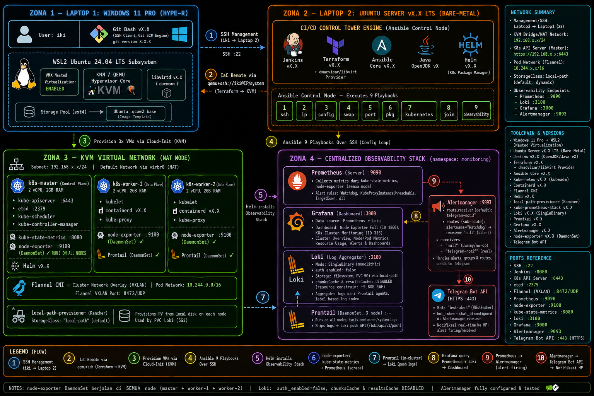

Masuk ke tahap lanjutan dari projek sebelumnya jika di projek sebelumnya itu belum menambahkan observ tools untuk monitoring dari infrastructure yang sudah di bangun sekarang saya akan membahas
cara untuk menambahkan stack observ tools seperti prometheus,loki,grafana,dan alertmanager.Karena kali ini hanya menambahkan dan mengintegrasikan observ tools jadinya untuk infrastructure 
itu masih sama saja dengan projek sebelumnya,oke langsung saja masuk ke pembahasaanya 


| Node        | CPU     | RAM  | Storage | Network                             |
|-------------|---------|------|---------|------------------------------------ |
| **Master**  | 2 cores | 2GB  | 10GB    | 1 Adapters   ( Static Ip )          |
| **Worker 1**| 2 cores | 2GB  | 10GB    | 1 Adapters   ( Static Ip )          |
| **Worker 2**| 2 cores | 2GB  | 10GB    | 1 Adapters   ( Static Ip )          |
| **Jenkins** | 7 cores | 7GB  | 240GB   |                Wlan                 |




### Structure Folder 

Untuk structure folder yang digunakan dalam projek ini ada tiga yang pertama itu untuk terraform dan yang kedua itu ansible terakhir itu ada di cluster,

```
terraform-setup/
├── .terraform/
├── compute.tf
├── main.tf
├── prep-vm.tf
```

dan yang kedua yaitu ansible

```
k8s/
├── ansible.cfg
├── inventory
├── playbook-allow-port.yaml
├── playbook-ip.yaml
├── playbook-install-java-baremetal.yaml
├── playbook-install-jenkins-baremetal.yaml
├── playbook-install-kubectl-baremetal.yaml
├── playbook-join.yaml
├── playbook-kubernetes.yaml
├── playbook-pkg.yaml
├── playbook-swap.yaml
├── playbook-config.yaml
├── playbook-install-terraform-bare-metal.yaml
├── observ.yaml
├── observ_2.yaml
```

yang terakhir di cluster

```
cluster-side/
├── alertmanager-telegram.yaml
```

### Tools

- **OS Laptop 1** : Windows 11 Pro
- **OS WSL2 Subsystem** : Ubuntu 24.04 LTS
- **OS Ubuntu VM (K8s Nodes)** : 24.04 LTS
- **OS Ubuntu Jenkins Node (Bare Metal)** : 25.04
- **Kubernetes** : 1.28
- **Containerd** : 2.2.4
- **Java** : 21
- **Jenkins** : 2.56
- **Network** : Flannel
- **Git Bash** : 2.51.1
- **Terraform** :  v1.15.6
- **Ansible** : v2.16+
- **Helm** : v3.x
- **Telegram Bot** :
- **KVM** : 8.2.2
- **QEMU** : 8.2.2
- **Libvirt** : 10.0.0
- **Alertmanager** : v0.93.1
- **Loki** : 3.6.11
- **Loki Canary** : 3.6.12
- **Loki Gateway (nginx)** : 1.29-alpine
- **Grafana** : 13.1.0
- **Prometheus Operator** : v0.93.1
- **Prometheus Config Reloader** : v0.93.1
- **Kube State Metrics** : v2.20.0
- **Prometheus** : v3.14.1
- **Node Exporter** : v1.12.0
- **Promtail** : 3.5.1

- ### Catatan Kompatibilitas
Dites pada: VM Ubuntu 22.04 (jammy, dari image cloud) dan node Jenkins Ubuntu 25.04.
Kalau memakai rilis Ubuntu lain, alur playbook dan module-nya sama. Yang perlu
disesuaikan hanya yang bergantung pada codename rilis:
- HashiCorp: ubah `hashicorp_suite` bila suite rilis belum ada di repo mereka.
- Docker: pastikan `download.docker.com` sudah punya suite untuk rilis tersebut.
- Terraform: ganti URL image di `prep-vm.tf`.


### prerequisites 
Oke sebelum masuk ke setup saya harapkan anda semua membaca ini,semua kondisi harus memenuhi 

 - **kubernetes.core**
 - **community.general**
 - **ansible.posix

 collection yang dibutuhkan tapi jika install ansible lewat pip ansible berarti semuanya 

